# Hey 👋 I'm Maruf

  

---

## 👨‍💻 About Me

Hi! I'm **Maruf**, a Computer Science & Engineering student at **BUBT** who enjoys building software and exploring new technologies.

I'm particularly interested in **Backend Development, Artificial Intelligence, Machine Learning, and Data Science**. I enjoy working with Python and building APIs and database-driven applications.

- 🎓 CSE student at **Bangladesh University of Business and Technology (BUBT)**
- 🌾 Currently building **FarmMarket** — a fair-price agricultural marketplace for Bangladeshi farmers
- 💻 Interested in **Backend Development and Software Engineering**
- 🐍 Working with **Python, FastAPI, Django & DRF, and TypeScript/React**
- 🗄️ Working with **MySQL, PostgreSQL, and SQLAlchemy**
- 🧩 Solved **300+ problems on LeetCode**
- 🤖 Exploring **Artificial Intelligence, Machine Learning, and Data Science**
- 🌱 Continuously improving my **Data Structures & Algorithms** skills
- 🚀 Interested in building practical and meaningful software projects
- 🤝 Open to collaborating on interesting **Backend, AI, and Open Source projects**
- ⚡ Fun fact: I enjoy learning new technologies by building real projects

---

## 🛠️ Tech Stack

  
  
  
  
  
  

  
  
  
  
  
  

  
  
  
  

  
  
  

  
  
  
  
  
  
  
  
  
  
  

---

## 🚀 Featured Projects

### 🌾 FarmMarket

An AI-powered, bilingual (Bangla/English) fair-price agricultural marketplace connecting farmers directly with buyers — no middlemen, no hidden margins. Built with Team Agronexis for a hackathon.

**Key Features:**
- 🤝 Smart demand matching between farmer listings and buyer demand
- 📈 8-week price forecasting with scikit-learn
- 🤖 Krishi Bondhu — Gemini-powered AI farming assistant (text, voice & image-based crop disease detection)
- 🚚 Logistics planning with live routes
- 🔳 QR-based Digital Twin batch tracking from farm to buyer
- 🌦️ Live weather and daily market prices across 5 hubs in Bangladesh

**Tech Stack:** React, TypeScript, Python, FastAPI, MySQL, scikit-learn, Google Gemini, Docker

🔗 [Live Demo](https://farmmarket-gdcm.onrender.com) · [View Project](https://github.com/marufHtuhin/FarmMarket)

---

### 📡 PulseWatch AI

An intelligent API monitoring and anomaly alert platform that watches your APIs around the clock and explains incidents in plain language.

**Key Features:**
- 📊 Real-time API monitoring with uptime, latency and status tracking
- 🚨 11-rule anomaly detection — slow responses, HTTP errors, timeouts, SSL expiry & more
- 🤖 AI-generated incident explanations with OpenRouter
- 📲 Instant Telegram alerts with severity filtering
- 📈 P50/P95/P99 latency percentiles and historical trends
- 🔐 Multi-user SaaS with JWT auth, forgot-password OTP and admin panel

**Tech Stack:** React, JavaScript, Python, FastAPI, MySQL, OpenRouter, Telegram Bot API, Docker

🔗 [Live Demo](https://pulsewatchai.vercel.app) · [View Project](https://github.com/marufHtuhin/PulseWatch-AI)

🧪 Try the live demo with `test@test.com` / `test@1234`

---

### 🐍 Snake Game AI

A Snake game built with Python and Pygame, featuring an autonomous AI mode that plays the game by itself using A* pathfinding with flood-fill safety checks — alongside classic manual play.

**Key Features:**
- 🧠 Autonomous AI gameplay with A* pathfinding
- 🛡️ Flood-fill safety checks so the AI never traps itself
- 🎮 Manual player controls
- 🌐 Playable web demo via GitHub Pages

**Tech Stack:** Python, Pygame, GitHub Pages

🔗 [Live Demo](https://marufhtuhin.github.io/Snake-Game-AI/) · [View Project](https://github.com/marufHtuhin/Snake-Game-AI)

---

### 🌾 AmaderKrishi AI

An AI-powered agriculture assistance system designed to help farmers with agricultural information and crop-related problems.

**Key Features:**
- 🤖 AI-powered agricultural chatbot
- 🇧🇩 Bangla language support
- 🌱 Crop disease assistance
- 📷 Image-based crop analysis
- 🎙️ Voice interaction
- 🔌 REST API-based backend

**Tech Stack:** Python, FastAPI, MySQL, AI/ML, HTML, CSS, JavaScript

🔗 [View Project](https://github.com/marufHtuhin/AmaderKrishi_AI)

---

### 🛒 Ecommerce Sales & Inventory System

A backend-focused Point of Sale API designed to manage products, users, authentication, and sales-related operations.

**Features:**
- 🔐 User authentication
- 📦 Product management
- 🛍️ Sales and inventory operations
- 🗄️ Database integration
- 🔌 RESTful API architecture

**Tech Stack:** Python, FastAPI, SQLAlchemy, MySQL, Pydantic

🔗 [View Project](https://github.com/marufHtuhin/Ecommerce-Sales-Inventory-System)

---

###

<picture data-importer="pacman">
  <source media="(prefers-color-scheme: dark)" srcset="https://raw.githubusercontent.com/marufHtuhin/marufHtuhin/pacman-output/galaga-contribution-graph-dark.svg?game=galaga">
  <source media="(prefers-color-scheme: light)" srcset="https://raw.githubusercontent.com/marufHtuhin/marufHtuhin/pacman-output/galaga-contribution-graph.svg?game=galaga">
  
</picture>

###

## 📊 GitHub Statistics

  

---

## 📫 Connect With Me

  

  

  

  

  

  

  

---

## 👀 Profile Views

  

---

  <b>⭐ Thanks for visiting my profile!</b>

  <i>Let's build something amazing together 🚀</i>

